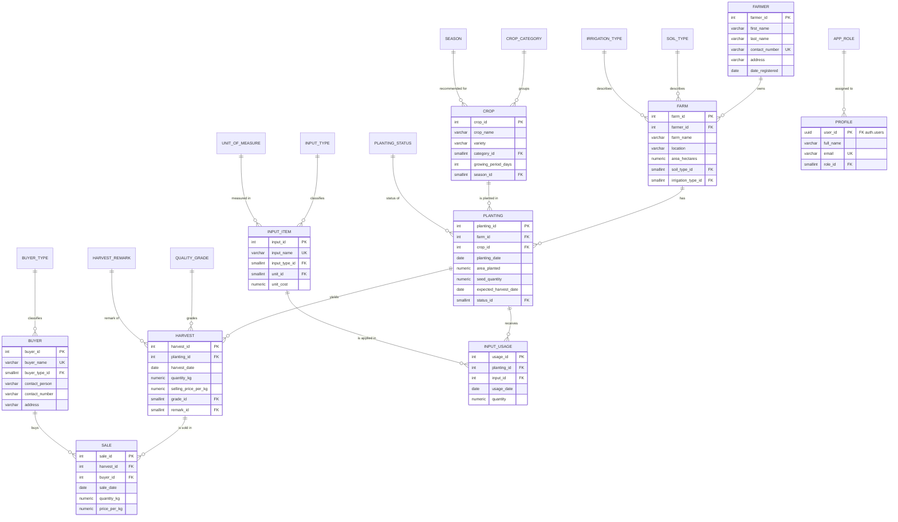
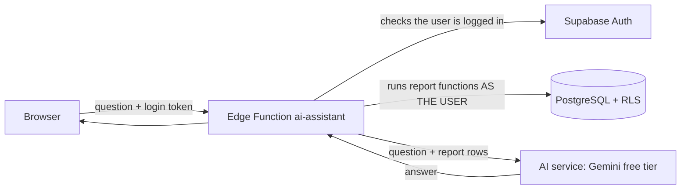

# Agriculture Information System

**Cebu Technological University – AP3 Midterm Project**
**Database:** Supabase PostgreSQL  **Application:** Web-based information system (Vite + JavaScript + Bootstrap 5 + Bootstrap Icons + Figtree font + Chart.js)

A web system for managing **farmers, farms, crops, planting records and harvest records**, plus **buyers, sales, farm inputs (fertilizers / pesticides) and input usage**. It has a live dashboard, 11 database-driven reports, login with three roles, Row Level Security, validation in both the app and the database, and an audit trail.

---

## Contents
1. [Objectives](#1-objectives)
2. [Functional requirements](#2-functional-requirements)
3. [Project files](#3-project-files)
4. [Setup – Supabase](#4-setup--supabase)
5. [Setup – web app](#5-setup--web-app)
6. [Deployment](#6-deployment)
7. [Entity-Relationship Diagram](#7-entity-relationship-diagram-erd)
8. [Normalization (UNF → 3NF)](#8-normalization-unf--1nf--2nf--3nf)
9. [Data dictionary](#9-data-dictionary)
10. [Relationships and constraints](#10-relationships-and-constraints)
11. [Security, roles and audit](#11-security-roles-and-audit)
12. [Reports and dashboard](#12-reports-and-dashboard)
13. [Where each requirement is met](#13-where-each-requirement-is-met)
14. [Testing results](#14-testing-results)
15. [User guide](#15-user-guide)
16. [Screenshots](#16-screenshots)
17. [AI features (optional)](#17-ai-features-optional)

---

## 1. Objectives
1. Design a relational database normalized from the unnormalized form to **Third Normal Form (3NF)**.
2. Host it on **Supabase PostgreSQL** with primary keys, foreign keys, NOT NULL, UNIQUE and CHECK constraints and lookup tables.
3. Build a working web system with full **CRUD**, **search / filter / sort / pagination**, and **validation**.
4. Protect data with **login, roles (Administrator / Staff / Viewer)** and **Row Level Security**, with no credentials in the source code.
5. Provide a **dashboard** and **reports** whose numbers come only from live database queries.
6. Record **audit information** (who created / changed what and when).

## 2. Functional requirements
| # | The system shall… |
|---|---|
| F1 | Let users sign in with email and password, and sign out. Unauthenticated visitors see only the login page. |
| F2 | Show a dashboard after login: 8 summary cards, 4 charts, recent plantings and recent harvests. |
| F3 | Create, view, update and delete **Farmers, Farms, Crops, Planting records, Harvest records, Buyers, Sales, Input items, Input usage**. |
| F4 | Use dropdowns for predefined values (showing a label, storing the numeric ID from a lookup table). |
| F5 | Search every module, filter by relevant fields and date range, sort by column, and page through results (10 / 25 / 50 rows). |
| F6 | Validate every form before saving, and show clear field-level error messages. |
| F7 | Ask for confirmation before deleting, and block deletes that would break referential integrity, with a friendly explanation. |
| F8 | Generate 11 reports with a date range (and status / grade / period where relevant), with totals, print and CSV export. |
| F9 | Restrict functions by role: Viewer = read only, Staff = add / edit, Administrator = everything + delete + user roles + audit log. |
| F10 | Record created / updated date and user for every record, and keep a full audit log of inserts, updates and deletes. |

## 3. Project files
| File | Purpose |
|---|---|
| `schema.sql` | Tables, lookup tables, constraints, indexes, triggers (audit + business rules), list views (JOINs) |
| `reports.sql` | Dashboard and report functions (all aggregation is done in SQL) |
| `security.sql` | Row Level Security on every table, role policies, privileges |
| `seed.sql` | Lookup values and sample data (same records as the project brief / original PHP installer) |
| `tests/db_tests.sql` | 48 automated database tests (constraints, rules, RLS per role, audit, reports) |
| `index.html` | Page shell: login screen, navbar, shared modal |
| `src/main.js` | Start-up, login / logout, menu, page routing, role guard |
| `src/supabaseClient.js` | Supabase connection using **environment variables** |
| `src/auth.js` | Current user, role and permission checks |
| `src/modules.js` | One description per module (columns, fields, filters, validation) |
| `src/crud.js` | Generic data table, search, filters, sorting, pagination, view / add / edit / delete |
| `src/dashboard.js` | Dashboard cards, charts and recent records |
| `src/reports.js` | Report page (filters, totals, print, CSV, AI summary) |
| `src/assistant.js`, `src/ai.js` | "Ask AI" chat page and the call to the AI Edge Function |
| `supabase/functions/ai-assistant/` | Supabase Edge Function for the AI features (holds the AI key on the server; free Gemini by default) |
| `src/ui.js`, `src/style.css` | Shared helpers (messages, formatting, modal) and styles |
| `.env.example` | Template for the two environment variables |

> `config.example.js` is left over from an earlier version and is no longer used. You can delete it.

## 4. Setup – Supabase
1. Create a project at [supabase.com](https://supabase.com).
2. Open **SQL Editor** and run the files **in this order** (open each file, paste, *Run*):
   1. `schema.sql`
   2. `reports.sql`
   3. `security.sql`
   4. `seed.sql`
3. **Authentication → Sign In / Providers:** turn **off** "Allow new users to sign up" (accounts are created by the Administrator).
4. **Authentication → Users → Add user → Create new user** for at least three accounts, ticking **Auto Confirm User**, e.g. `admin@…`, `staff@…`, `viewer@…`. A profile with role *Viewer* is created automatically.
5. Give them roles in the SQL Editor:
   ```sql
   update profile set role_id = 1 where email = 'admin@example.com';   -- Administrator
   update profile set role_id = 2 where email = 'staff@example.com';   -- Staff
   -- everyone else stays Viewer (3). Later, the Administrator can change roles in the app (Admin → Users & Roles).
   ```
6. (Optional, recommended) Run `tests/db_tests.sql` in the SQL Editor. Every row should say **PASS**. The script undoes all of its own changes.

## 5. Setup – web app
Requires [Node.js](https://nodejs.org) 18 or newer.
```bash
npm install
cp .env.example .env          # Windows: copy .env.example .env
```
Edit `.env` and paste the values from **Supabase → Project Settings → API**:
```
VITE_SUPABASE_URL=https://xxxxxxxx.supabase.co
VITE_SUPABASE_ANON_KEY=<the anon / publishable key>
```
```bash
npm run dev                   # opens http://localhost:5173
```
- Use only the **anon / publishable** key. It is designed to be public. **Row Level Security** decides what each logged-in user can do.
- **Never** use the `service_role` / secret key in the browser or in `.env` for this app.
- `.env` is in `.gitignore`, so your values are never committed.

## 6. Deployment
`npm run build` produces a static site in `dist/`.
- **Netlify:** New site → import the repository → Build command `npm run build`, Publish directory `dist` → *Site settings → Environment variables*: add `VITE_SUPABASE_URL` and `VITE_SUPABASE_ANON_KEY` → Deploy.
- **Vercel:** Import project → Framework *Vite* → *Settings → Environment Variables*: add the same two → Deploy.
- In Supabase **Authentication → URL Configuration**, set *Site URL* to your deployed address.

## 7. Entity-Relationship Diagram (ERD)

Every core table also has `created_at`, `updated_at`, `created_by`, `updated_by` (omitted above for space). `AUDIT_LOG` stores a copy of every change. Passwords live in Supabase's `auth.users` (hashed), not in our tables.

## 8. Normalization (UNF → 1NF → 2NF → 3NF)

### Unnormalized form (UNF)
One record per farmer with repeating groups and descriptive text:

> **FARMER_RECORD** (farmer_name, contact_number, address, date_registered,
> **{** farm_name, location, area_hectares, soil_type, irrigation_type,
> **{** crop_name, variety, crop_category, growing_period_days, recommended_season, planting_date, area_planted, seed_quantity, expected_harvest_date, status,
> **{** harvest_date, quantity_kg, selling_price_per_kg, quality_grade, remarks, estimated_value **}** **}** **}**)

Problems: repeating groups (a farmer has many farms, each farm many plantings, each planting many harvests); a non-atomic name; the same text ("Irrigated", "Grade A", "Good harvest") typed again and again.

### First Normal Form (1NF)
*Every value atomic, no repeating groups.* Split the name into `first_name` and `last_name`, then flatten to **one row per harvest event**:

> **AGRI_1NF** (<u>first_name, last_name, farm_name, crop_name, variety, planting_date, harvest_date</u>, contact_number, address, date_registered, location, area_hectares, soil_type, irrigation_type, crop_category, growing_period_days, recommended_season, area_planted, seed_quantity, expected_harvest_date, status, quantity_kg, selling_price_per_kg, quality_grade, remarks, estimated_value)

The key is composite (underlined). Farmer, farm and crop facts are repeated on every row, which causes update anomalies.

### Second Normal Form (2NF)
*Remove partial dependencies:* every non-key column must depend on the **whole** key.
| Depends only on… | Columns | New table |
|---|---|---|
| the farmer | contact_number, address, date_registered | **FARMER** (farmer_id, first_name, last_name, contact_number, address, date_registered) |
| the farm | location, area_hectares, soil_type, irrigation_type | **FARM** (farm_id, farmer_id, farm_name, location, area_hectares, soil_type, irrigation_type) |
| the crop | crop_category, growing_period_days, recommended_season | **CROP** (crop_id, crop_name, variety, crop_category, growing_period_days, recommended_season) |
| farm + crop + planting date | area_planted, seed_quantity, expected_harvest_date, status | **PLANTING** (planting_id, farm_id, crop_id, planting_date, area_planted, seed_quantity, expected_harvest_date, status) |
| the harvest event | quantity_kg, price, grade, remarks, estimated_value | **HARVEST** (harvest_id, planting_id, harvest_date, quantity_kg, selling_price_per_kg, quality_grade, remarks, estimated_value) |

Each table gets a single-column surrogate primary key (identity), and parents are linked by foreign keys. Sales and input usage are separate events and follow the same rule (**BUYER**, **SALE**, **INPUT_ITEM**, **INPUT_USAGE**).

### Third Normal Form (3NF)
*Remove transitive dependencies* (non-key → non-key):
1. **Repeated descriptive values become lookup tables** referenced by ID:
   `soil_type`, `irrigation_type` (FARM); `crop_category`, `season` (CROP); `planting_status` (PLANTING); `quality_grade`, `harvest_remark` (HARVEST); `buyer_type` (BUYER); `input_type`, `unit_of_measure` (INPUT_ITEM); `app_role` (PROFILE).
   Changing "Drip Irrigation" now happens in one row, typos are impossible, and every dropdown in the app shows the label while storing the ID (requirement 3).
2. **Derived values are not stored:** `estimated_value = quantity_kg × selling_price_per_kg` was removed from HARVEST (it depends on two non-key columns). It is calculated in views and reports, along with `sale amount = quantity_kg × price_per_kg` and `input cost = quantity × unit_cost`.
3. **Kept on purpose:** `expected_harvest_date` stays in PLANTING. It is a *planning estimate* the farmer can adjust, so it is not always equal to `planting_date + growing_period_days`. The app pre-fills it from the crop's growing period.
4. `variety` stays in CROP, as in the project brief: each crop row is one crop-and-variety combination (UNIQUE `crop_name, variety`).

**Final 3NF tables (22):** farmer, farm, crop, planting, harvest, buyer, sale, input_item, input_usage, profile, audit_log, and 11 lookup tables (app_role, crop_category, season, soil_type, irrigation_type, planting_status, quality_grade, harvest_remark, buyer_type, input_type, unit_of_measure).

## 9. Data dictionary
Abbreviations: **PK** primary key · **FK** foreign key · **NN** NOT NULL · **UQ** UNIQUE · **CK** CHECK

### FARMER – farmers registered in the system
| Column | Type | Rules |
|---|---|---|
| farmer_id | integer identity | PK |
| first_name | varchar(50) | NN, CK not blank |
| last_name | varchar(50) | NN, CK not blank |
| contact_number | varchar(20) | NN, UQ, CK `09XXXXXXXXX` or `+639XXXXXXXXX` |
| address | varchar(150) | NN, CK not blank |
| date_registered | date | NN, default today, CK ≥ 2000-01-01 (app: not in the future) |

### FARM – farms owned by farmers
| Column | Type | Rules |
|---|---|---|
| farm_id | integer identity | PK |
| farmer_id | integer | NN, FK → farmer (ON DELETE RESTRICT) |
| farm_name | varchar(100) | NN; UQ (farmer_id, farm_name) |
| location | varchar(150) | NN |
| area_hectares | numeric(8,2) | NN, CK > 0 and ≤ 10 000 |
| soil_type_id | smallint | NN, FK → soil_type |
| irrigation_type_id | smallint | NN, FK → irrigation_type |

### CROP – crop master data
| Column | Type | Rules |
|---|---|---|
| crop_id | integer identity | PK |
| crop_name | varchar(80) | NN; UQ (crop_name, variety) |
| variety | varchar(80) | NN |
| category_id | smallint | NN, FK → crop_category |
| growing_period_days | integer | NN, CK 1–1825 |
| season_id | smallint | NN, FK → season (recommended season) |

### PLANTING – crop planting transactions
| Column | Type | Rules |
|---|---|---|
| planting_id | integer identity | PK |
| farm_id | integer | NN, FK → farm (RESTRICT) |
| crop_id | integer | NN, FK → crop (RESTRICT) |
| planting_date | date | NN |
| area_planted | numeric(8,2) | NN, CK > 0; trigger: ≤ farm area |
| seed_quantity | numeric(8,2) | NN, CK ≥ 0 (kg) |
| expected_harvest_date | date | NN, CK > planting_date |
| status_id | smallint | NN, default 1, FK → planting_status |

### HARVEST – harvest transactions
| Column | Type | Rules |
|---|---|---|
| harvest_id | integer identity | PK |
| planting_id | integer | NN, FK → planting (RESTRICT) |
| harvest_date | date | NN; trigger: ≥ planting date |
| quantity_kg | numeric(10,2) | NN, CK > 0; trigger: ≥ kg already sold |
| selling_price_per_kg | numeric(10,2) | NN, CK ≥ 0 |
| grade_id | smallint | NN, FK → quality_grade |
| remark_id | smallint | NN, FK → harvest_remark |

### BUYER – who buys the produce
| Column | Type | Rules |
|---|---|---|
| buyer_id | integer identity | PK |
| buyer_name | varchar(100) | NN, UQ |
| buyer_type_id | smallint | NN, FK → buyer_type |
| contact_person | varchar(100) | optional |
| contact_number | varchar(20) | NN, CK mobile or landline format |
| address | varchar(150) | NN |

### SALE – sale of (part of) a harvest
| Column | Type | Rules |
|---|---|---|
| sale_id | integer identity | PK |
| harvest_id | integer | NN, FK → harvest (RESTRICT) |
| buyer_id | integer | NN, FK → buyer (RESTRICT) |
| sale_date | date | NN; trigger: ≥ harvest date |
| quantity_kg | numeric(10,2) | NN, CK > 0; trigger: total sold ≤ harvest quantity |
| price_per_kg | numeric(10,2) | NN, CK ≥ 0 |

### INPUT_ITEM – fertilizers, pesticides, herbicides…
| Column | Type | Rules |
|---|---|---|
| input_id | integer identity | PK |
| input_name | varchar(100) | NN, UQ |
| input_type_id | smallint | NN, FK → input_type |
| unit_id | smallint | NN, FK → unit_of_measure |
| unit_cost | numeric(10,2) | NN, CK ≥ 0 |

### INPUT_USAGE – input applied to a planting
| Column | Type | Rules |
|---|---|---|
| usage_id | integer identity | PK |
| planting_id | integer | NN, FK → planting (RESTRICT) |
| input_id | integer | NN, FK → input_item (RESTRICT) |
| usage_date | date | NN; trigger: ≥ planting date |
| quantity | numeric(10,2) | NN, CK > 0 |

### Audit columns (all nine tables above)
| Column | Type | Filled by |
|---|---|---|
| created_at / updated_at | timestamptz | trigger `set_audit_fields()` |
| created_by / updated_by | uuid → auth.users | trigger, from `auth.uid()` (cannot be faked by the client) |

### PROFILE – application users (linked to Supabase Auth)
| Column | Type | Rules |
|---|---|---|
| user_id | uuid | PK, FK → auth.users (ON DELETE CASCADE) |
| full_name | varchar(100) | NN |
| email | varchar(255) | NN, UQ |
| role_id | smallint | NN, default 3 (Viewer), FK → app_role; trigger keeps ≥ 1 Administrator |
| created_at / updated_at | timestamptz | NN |

### AUDIT_LOG – history of every insert / update / delete
`audit_id` bigint PK · `table_name` · `record_id` · `action` CK (INSERT, UPDATE, DELETE) · `changed_by` uuid · `changed_at` timestamptz · `old_data` jsonb · `new_data` jsonb

### Lookup tables (`id` smallint identity PK, `name` NN UQ)
| Table | Values |
|---|---|
| app_role | 1 Administrator, 2 Staff, 3 Viewer |
| crop_category | 1 Cereal, 2 Vegetable, 3 Fruit, 4 Legume, 5 Root Crop |
| season | 1 Wet Season, 2 Dry Season, 3 Year Round |
| soil_type | 1 Loam, 2 Clay Loam, 3 Sandy Loam, 4 Clay, 5 Silt Loam |
| irrigation_type | 1 Rainfed, 2 Irrigated, 3 Drip Irrigation |
| planting_status | 1 Planted, 2 Growing, 3 Harvested, 4 Failed |
| quality_grade | 1 Grade A, 2 Grade B, 3 Grade C |
| **harvest_remark** | **1 Good Harvest, 2 Acceptable Quality, 3 Low Yield, 4 Poor Quality, 5 Damaged Harvest** (exactly as in the brief) |
| buyer_type | 1 Wholesaler, 2 Retailer, 3 Cooperative, 4 Food Processor, 5 Market Vendor |
| input_type | 1 Inorganic Fertilizer, 2 Organic Fertilizer, 3 Insecticide, 4 Fungicide, 5 Herbicide |
| unit_of_measure | 1 Kilogram (kg), 2 Liter (L), 3 Sack (50 kg) (also has UQ `unit_code`) |

## 10. Relationships and constraints
| Relationship | Type | FK | On delete |
|---|---|---|---|
| FARMER → FARM | 1 : M | farm.farmer_id | RESTRICT |
| FARM → PLANTING | 1 : M | planting.farm_id | RESTRICT |
| CROP → PLANTING | 1 : M | planting.crop_id | RESTRICT |
| PLANTING → HARVEST | 1 : M | harvest.planting_id | RESTRICT |
| HARVEST → SALE | 1 : M | sale.harvest_id | RESTRICT |
| BUYER → SALE | 1 : M | sale.buyer_id | RESTRICT |
| PLANTING → INPUT_USAGE | 1 : M | input_usage.planting_id | RESTRICT |
| INPUT_ITEM → INPUT_USAGE | 1 : M | input_usage.input_id | RESTRICT |
| each lookup → its table | 1 : M | *_id | NO ACTION (blocked while in use) |
| auth.users → PROFILE | 1 : 1 | profile.user_id | CASCADE |

**Delete rule (requirement 11):** a record that is still referenced cannot be deleted. For example, deleting a farmer who still owns farms is blocked, and the app explains *"This farmer still owns one or more farms. Delete or reassign those farms first."* RESTRICT was chosen over CASCADE so one click can never silently wipe out a farmer's whole history.

**Business rules enforced by triggers** (a CHECK can only see its own row):
- area planted ≤ farm area; a farm cannot shrink below a planting on it
- harvest date ≥ planting date; usage date ≥ planting date; sale date ≥ harvest date
- total kg sold ≤ harvested kg; a harvest cannot be reduced below what was sold
- at least one Administrator must always exist

**Indexes:** on every foreign key and on search / sort columns (last_name, address, location, planting_date, harvest_date, sale_date, usage_date, audit table + record).

## 11. Security, roles and audit
| Action | Administrator | Staff | Viewer | Not logged in |
|---|:-:|:-:|:-:|:-:|
| Dashboard, lists, view, reports | ✔ | ✔ | ✔ | ✖ |
| Add / edit records | ✔ | ✔ | ✖ | ✖ |
| Delete records | ✔ | ✖ | ✖ | ✖ |
| Edit lookup tables (Supabase Table Editor / SQL) | ✔ | ✖ | ✖ | ✖ |
| Users & Roles page, Audit Log page | ✔ | ✖ | ✖ | ✖ |

- **Passwords** are handled by Supabase Auth and stored as bcrypt hashes. This project never stores or sees a password.
- **Row Level Security** is enabled on all 22 tables (`security.sql`). The policies use `current_role_id()`, which reads the role of `auth.uid()`. Hiding buttons in the app is only for convenience; the database enforces the rules even if someone calls the API directly.
- The `anon` role (not logged in) has **all privileges revoked**, so it cannot read tables, views or report functions.
- All views use `security_invoker = true`, so RLS also applies through views.
- **No secrets in source code:** the URL and anon key come from environment variables (`.env`, git-ignored, or the hosting dashboard).
- **Error messages** never show SQL, keys or URLs. Technical details go to the browser console only.
- **Audit:** `created_at / updated_at / created_by / updated_by` on every record (shown in the *View* dialog), plus `audit_log` with before / after data for every change (Admin → Audit Log).

## 12. Reports and dashboard
**Dashboard** (all values from `dashboard_totals()` and the report functions):
- Cards: total farmers, farms, crops, planting records, harvest records, total farm area (ha), total harvested quantity (kg), sales revenue (₱). Each card links to its module or report.
- Charts: harvest per crop, monthly sales revenue, production by location, plantings by status. Each has a "Table view" link to the matching report.
- Tables: 5 most recent planting records and harvest records.

**Reports** (`reports.sql`, page *Reports*). All accept a date range; totals row, print / save as PDF, CSV download:
| Report | SQL function | Extra filter |
|---|---|---|
| Farmers and their farms | `rpt_farmers_farms` | – |
| Crops planted per farm | `rpt_crops_per_farm` | – |
| Planting summary by status | `rpt_planting_status_summary` | – |
| Planting records by status (detail) | `rpt_planting_by_status` | status |
| Harvest records (with estimated value) | `rpt_harvest_records` | quality grade |
| Total harvest & estimated value per crop | `rpt_harvest_per_crop` | – |
| Total harvest per season | `rpt_harvest_per_season` | – |
| Farmer production summary | `rpt_farmer_production` | – |
| Sales and revenue per period | `rpt_sales_per_period` | month / quarter / year |
| Input / fertilizer usage per farm | `rpt_input_usage_per_farm` | – |
| Production by location | `rpt_production_by_location` | – |

*Season* is taken from the harvest month (Philippine climate): **Wet Season = June–November, Dry Season = December–May**.

## 13. Where each requirement is met
| # | Requirement (project brief) | Where |
|---|---|---|
| 1 | Normalization UNF → 3NF, PK / FK / relationships | §8 of this README, header of `schema.sql` |
| 2 | Supabase database; app reads / writes it; credentials secured | `schema.sql`, `src/supabaseClient.js`, `.env.example`, `.gitignore` |
| 3 | Controlled dropdowns, label shown / ID stored, lookup tables + FK | 11 lookup tables in `schema.sql`; `LOOKUPS` + `type: 'select'` in `src/modules.js`; harvest remarks 1–5 exactly as specified |
| 4 | CRUD for Farmers, Farms, Crops, Plantings, Harvests; JOINs | `src/crud.js` + `src/modules.js`; list views `v_*_list` in `schema.sql` (e.g. plantings show farm, farmer and crop) |
| 5 | Dashboard as main page, 5 count cards, recent records, plantings by status, total harvested, charts, navigation | `src/dashboard.js`, `dashboard_totals()` |
| 6 | Login page, protected pages, 2+ roles, role restrictions, hashed passwords | `src/main.js`, `src/auth.js`, `security.sql`, Supabase Auth |
| 7 | Input validation (required, numeric ranges, dates, FK) in app **and** DB | `validateForm()` and `validate()` rules in `src/crud.js` / `src/modules.js`; CHECK / NOT NULL / FK / trigger rules in `schema.sql` |
| 8 | Search, filter, sort per module | Search box, filter dropdowns, date range and sortable headers on every list (`src/crud.js`) |
| 9 | Reports incl. estimated harvest value, date-range filtering, from DB queries | `reports.sql`, `src/reports.js` |
| 10 | Data tables with headings, pagination, View / Edit / Delete | `src/crud.js` (10 / 25 / 50 rows, page numbers) |
| 11 | Confirmation before delete; FK-safe deletion | `confirmDelete()` in `src/crud.js`; `ON DELETE RESTRICT` |
| 12 | Responsive, consistent UI (Bootstrap) | `index.html`, `src/style.css` (dark theme with a left sidebar, green accent, icons, sticky table headers, colored badges, toast messages, visible focus outlines; prints in black on white); less important columns hide on phones |
| 13 | Success / error messages, no technical details shown | `showAlert()` and `friendlyError()` in `src/ui.js` |
| 14 | created_at / updated_at, responsible user | Audit columns + triggers + `audit_log` (`schema.sql`); *View* dialog; Admin → Audit Log |
| 15 | PK, FK, NOT NULL, UNIQUE, CHECK, referential integrity | `schema.sql`, §9–10 |
| 16 | Documentation | This README (screenshots: §16) |
| 17 | System testing incl. invalid input | `tests/db_tests.sql`, §14 |
| 18 | Hosted on Supabase, env-variable config, demo-ready | §4–6 |

## 14. Testing results

### Automated database tests – `tests/db_tests.sql`
Run in the Supabase SQL Editor; each line reports PASS / FAIL and all changes are rolled back. **Result during development: 48 / 48 PASS.**
| Area | What is tested |
|---|---|
| Constraints (11) | blank name, bad phone, duplicate phone (UNIQUE), missing address (NOT NULL), farm area 0, unknown farmer (FK), duplicate crop + variety, expected date before planting, 0 kg harvest, remark ID 9 (FK), valid insert accepted |
| Business rules (7) | planting larger than farm, harvest before planting, harvest reduced below sold, over-selling, sale before harvest, usage before planting, demoting last Administrator |
| Delete rules (3) | farmer with farms, crop in use, lookup value in use – all blocked |
| Security (15) | anon cannot read tables or run reports; Viewer reads but cannot add or edit; Staff adds and edits but cannot delete, edit lookups, read the audit log or promote themself; Admin deletes, reads the audit log and changes roles; Viewer sees only their own profile |
| Audit (3) | created_by / updated_by / updated_at set automatically; changes copied to audit_log |
| Reports (9) | dashboard totals, harvest per crop, total kg (41,750), date-range filter, status summary, sales per month / quarter / year, input usage |

### Application walkthrough (browser)
The app was driven in Microsoft Edge (automated) against a local copy of the database with RLS active. **Result: 82 / 82 checks passed, no JavaScript errors.**
| # | Test | Expected | Result |
|---|---|---|---|
| 1 | Login with wrong password | "Sign-in failed" message, no access | PASS |
| 2 | Login as Administrator | Dashboard with live totals and 4 charts | PASS |
| 3 | Farmers list, page 2, search "Carcar City, Cebu", address filter, sort by name ▼ | Correct rows each time | PASS |
| 4 | Save empty farmer form | 4 required-field errors | PASS |
| 5 | Phone "12345" | App validation message | PASS |
| 6 | Duplicate phone | Friendly "already uses this contact number" (from DB UNIQUE) | PASS |
| 7 | Add, view (audit info), edit farmer | Success messages; created / updated by shown | PASS |
| 8 | Delete farmer who owns a farm | Confirmation, then blocked with explanation | PASS |
| 9 | Delete unused farmer | Confirmation, then success | PASS |
| 10 | Planting: choose crop + date | Expected harvest date auto-filled (+115 days for rice) | PASS |
| 11 | Planting larger than farm (2 ha on 1.75 ha) | Rejected with message | PASS |
| 12 | Harvest dated before planting | Rejected with message | PASS |
| 13 | Harvest remark dropdown | Shows "Good Harvest"…; stores 1–5 | PASS |
| 14 | Filter plantings by status / harvests by grade | Correct counts | PASS |
| 15 | Sale of 400 kg when 360 kg left | Rejected: "Only 360 kg … left" | PASS |
| 16 | Farms, Crops, Buyers, Input Items, Input Usage, Users, Audit Log pages | Load with data | PASS |
| 17 | All 11 reports; date range; "from" after "to"; sales by quarter | Correct output / validation message | PASS |
| 18 | Logout | Back to login page | PASS |
| 19 | Staff account | Add / Edit visible, no Delete, no Admin menu, admin pages redirected | PASS |
| 20 | Viewer account | View only (no Add / Edit / Delete) | PASS |
| 21 | Phone-size screen (390 px) | Usable, no sideways page scroll; menu opens with ☰ | PASS |
| 22 | Look and feel | Icons on cards and menu, colored status / grade / remark badges, sticky table header, zebra rows, tooltips on icon buttons, empty-state message, two-column form, Save button disabled with spinner while saving, toast messages, print layout hides menu and filters | PASS |
| 23 | Widths 390–1920 px | No sideways scroll; sidebar on desktop, slide-out menu on phones and tablets | PASS |

> Repeat tests 1–23 on your deployed Supabase project and attach screenshots as evidence.

## 15. User guide
1. **Sign in** with the email and password the Administrator gave you. You land on the **Dashboard**.
2. **Navigate** with the menu on the left: Dashboard, Farmers, Farms, Crops, Plantings, Harvests, *Sales* (Buyers, Sales), *Inputs* (Input Items, Input Usage), Reports, and *Admin* (Administrators only). On a phone or tablet, tap ☰ at the top left.
3. **Find records:** type in *Search*, choose a filter or date range, click a column heading to sort (click again to reverse), and use the page buttons or *Rows* to page. *Clear* resets everything.
4. **Add:** click **+ Add …**, fill the fields marked *, and press **Save** (it shows "Saving..." until the database answers). Red messages under a field explain what to fix. Planting forms fill in the expected harvest date for you, and sale forms fill in the price from the harvest.
5. **View / Edit / Delete:** use the small icon buttons on each row (eye = view, pencil = edit, bin = delete; hover for a label). Success and error messages pop up in the bottom-right corner. *View* also shows who created and last changed the record. *Delete* (Administrator only) asks for confirmation and refuses if other records still use the item.
6. **Reports:** choose a report, optionally set *From / To* and the extra filter, and press **Run report**. Use **AI summary** for a short written summary, or **Print / PDF** / **Export CSV** at the top of the page.
7. **Ask AI:** open *Ask AI* in the menu and type a question such as "Which crop had the biggest harvest in May?". The answer lists the report(s) it used; click one to open that report and check the numbers.
8. **Administrators:** *Admin → Users & Roles* changes a user's role (new users are added in Supabase → Authentication). *Admin → Audit Log* shows every change with before / after values.
9. **Log out** with the button at the top right.

## 16. Screenshots
Take these from your running system (Supabase-connected) and add them here or to your documentation:
1. Login page (and the wrong-password message)
2. Dashboard (Administrator)
3. Farmers list with a search and filter applied
4. Add / Edit form showing validation errors
5. Delete confirmation, and the "cannot delete" message
6. Planting Records and Harvest Records lists (joined farm / crop names)
7. Harvest form with the Remarks dropdown open
8. Sales and Input Usage lists
9. Each report (at least one with a date range)
10. Users & Roles and Audit Log (Administrator)
11. Staff and Viewer views (no Delete / no Add)
12. Phone-size view
13. Supabase: Table Editor (tables), Authentication → Users, and the `db_tests.sql` result grid
14. Ask AI page with an answer and its source chip, and a report with an AI summary

## 17. AI features (optional)
Two AI features. The rest of the system works without them.

| Feature | Where | What it does |
|---|---|---|
| **AI summary** | Reports page → *AI summary* | Writes 3–5 sentences about the report on screen (totals, highest / lowest, trends). |
| **Ask AI** | Menu → *Ask AI* | Answers questions in plain English. The AI chooses which report to run, reads the rows, and answers. Every answer lists its source reports. |

**AI service:** by default the **free tier of Google Gemini** (`gemini-3.8-flash`), so the features cost nothing. Free use has daily limits; when they are reached the app says so and asks to try later. Google may use free-tier requests to improve its products. This project only uses fictional sample data, so this is acceptable here. With real farmer data, use a paid tier instead. The code can also use Anthropic Claude (paid) or any other OpenAI-compatible service by changing secrets only.

### How it works (and why it is safe)

- **The AI key never reaches the browser.** It is a Supabase *secret*, read only inside the Edge Function.
- **Only logged-in users** get answers; the anon key alone is refused.
- **The AI can only read data through the 11 report functions** in `reports.sql` (listed in `supabase/functions/ai-assistant/reports.ts`). It cannot write SQL or add / edit / delete records.
- **Row Level Security still applies:** reports run with the user's own login.
- Answers and summaries are labelled as AI-written, with a reminder to check the numbers.

| File | Purpose |
|---|---|
| `supabase/functions/ai-assistant/index.ts` | Entry point of the Edge Function |
| `supabase/functions/ai-assistant/assistant.ts` | Login check, report tools, prompts, the two modes |
| `supabase/functions/ai-assistant/providers.ts` | The AI services: free OpenAI-compatible (Gemini) and paid Claude |
| `supabase/functions/ai-assistant/reports.ts` | The only reports the AI may run, and filter validation |

### Setup (free)
1. Get a free key at **aistudio.google.com** → *Get API key* → *Create API key* (Google account, no credit card).
2. Supabase dashboard → **Edge Functions → Secrets** → add `AI_API_KEY` = your Gemini key → **Save**. Never put the key in `.env` or the code.
3. Deploy the function from the project folder (VS Code terminal):
   ```bash
   npx supabase login                                   # approve in the browser
   npx supabase functions deploy ai-assistant --project-ref <your-project-ref> --use-api
   ```
   `<your-project-ref>` is the id in your Supabase URL (`https://<ref>.supabase.co`). `--use-api` means Docker is not needed.
4. Reload the app. Function logs (with token use per request) are in Supabase → *Edge Functions → ai-assistant → Logs*.

**Busy or out of free quota:** free models are sometimes overloaded ("high demand"). The function then waits a moment and retries, and if the model is still busy (or its free daily limit is used up) it switches to backup free models: `gemini-3.5-flash-lite`, then `gemini-2.5-flash`. Only when all are busy does the app show "The free AI is very busy right now".

**Optional secrets:** `AI_MODEL` (another Gemini model, e.g. `gemini-3.5-flash-lite`), `AI_FALLBACK_MODELS` (comma-separated backup models; empty = none), `AI_REASONING` (Gemini thinking level, default `low`), `AI_BASE_URL` (another OpenAI-compatible service, e.g. `https://api.groq.com/openai/v1/` with a Groq key and model). To use **Claude** (paid) instead: remove `AI_API_KEY` and set `ANTHROPIC_API_KEY` (default model `claude-opus-5-5`, server-side fallback enabled).

If the function is not deployed, the app says so and everything else keeps working.

### Testing
- **Edge Function (37 checks, all pass):** login required, anon key refused, setup message when no key, CORS, request validation, report filters (dates, status, grade, month/quarter/year), empty report answered without using the AI quota, tool calls in the OpenAI format with Gemini's hidden "thought signatures" passed back, real report data (e.g. May 2026 = 7 harvests), invalid or broken AI input returned as an error result, content filter, loop limit, free-limit (429) message, wrong key / wrong model / service down messages, key never shown in errors, Claude path still working. Run against the local database copy with a simulated AI service.
- **Browser (19 checks, all pass):** AI summary shown and cleared on a new run, filters passed through, error toast, Ask AI examples, answer formatting, source chip links, follow-up questions, HTML in a question escaped, chat cleared on logout, Viewer access, phone layout.
- **Not yet tested with the real AI service** (needs your key): check a few answers against the reports before your demo.
